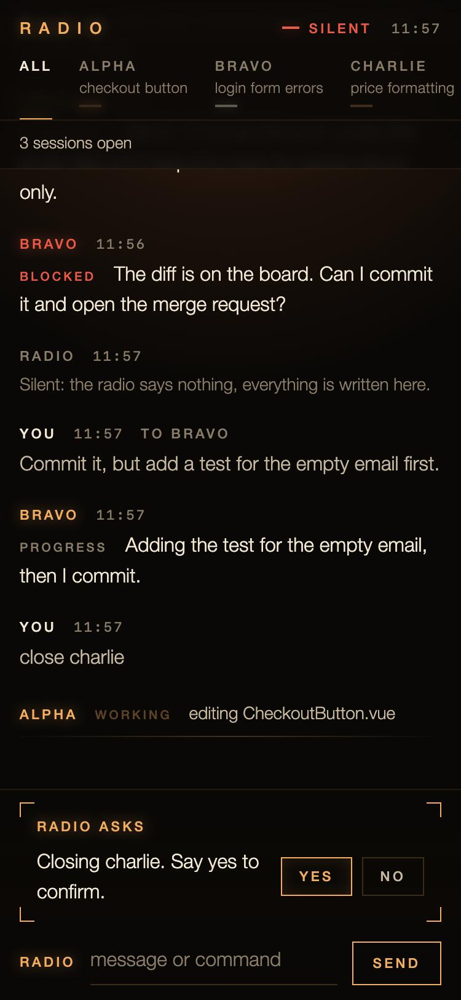
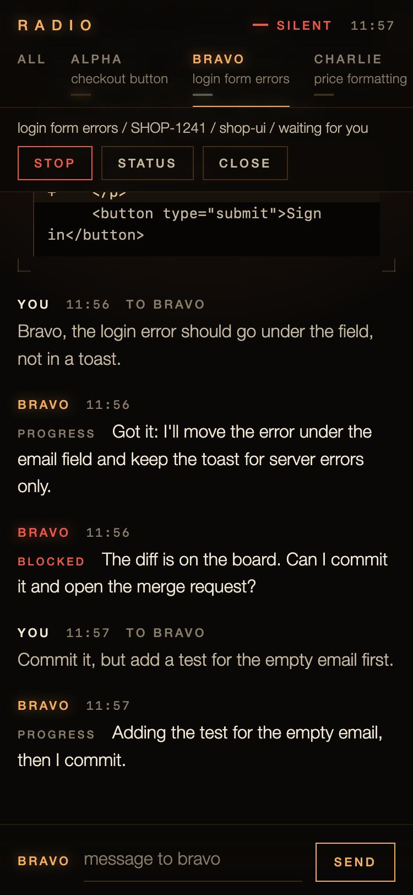

# claude-radio

Drive several [Claude Code](https://claude.com/claude-code) sessions by voice, with headphones and a phone in your pocket, away from the desk.

You talk over a push-to-talk voice radio ([Mumble](https://www.mumble.info/)). A bot transcribes what you say with [whisper.cpp](https://github.com/ggml-org/whisper.cpp), sends it to the right Claude Code session, and reads the replies back to you with [Piper](https://github.com/OHF-Voice/piper1-gpl), each session in its own voice. Code, diffs, drafts and screenshots that make no sense read aloud go to a small web page on your phone, the board, which is also a text console for when you can't talk.

<p align="center">
  
  &nbsp;
  
</p>
<p align="center"><sub>The board on a phone: the conversation, what the sessions show you, and a box to type when you can't talk (demo content).</sub></p>

```
phone (Mumla, Tailscale) ──voice──▶ Mumble server ◀──▶ bot ──▶ whisper.cpp (speech to text)
                                                        │  ──▶ Piper (text to speech)
                                                        │
                         board (web page) ◀── show ──┐  │ HTTP + SSE
                                                     │  ▼
                          Claude Code sessions in tmux, each with the radio MCP channel
                          (reply, show, move tools; status from Claude Code hooks)
```

Everything runs on one machine that stays on at home (developed on a Mac with Apple Silicon), reachable only over [Tailscale](https://tailscale.com/): no port is exposed to the internet, and nothing is sent to paid services beyond your own Claude subscription.

It is a personal project built for one person's daily work, shared as is. Expect to adapt it.

## What it does

- **Sessions with names.** Sessions get NATO names (alpha, bravo, charlie...). "Bravo, run the tests" goes to bravo; a sentence without a name goes to the last session you heard, or the bot asks "Who is that for, echo or charlie?". Names misheard by Whisper ("Foxfot", "Sharlie") are matched approximately.
- **Topics.** Each session says in two or three words what it works on ("media viewer zoom"); the bot uses them in confirmations and roll calls, so you don't have to remember who is who.
- **Opening projects by voice.** "Open the ui library for ticket 1234 and add a close button to the modal": the launcher creates a git worktree on a new branch (`SHOP-1234-alpha`), copies your ignored files, installs dependencies and starts a session with your request. Projects you don't register are found by a "lobby" session that moves into the right folder.
- **Feedback while Claude works.** A short acknowledgement first, a sentence at each milestone, ticks while it works, "done" or "blocked" at the end; a session waiting for you or stuck on a terminal dialog is announced.
- **It doesn't talk over you.** While you transmit the bot holds its sentences and plays them in order afterwards.
- **The board.** Sessions post text, code, diffs, files, images and audio with the `show` tool; you read them on your phone and answer by voice ("Bravo, ok, commit").
- **Typing instead of talking.** In a meeting or on a train: the board shows the whole conversation, takes every voice command as text, answers the radio's questions with buttons, and a silent switch keeps the radio quiet while everything is written.
- **The operator.** "Operator, close everyone except bravo", "Operator, which worktrees can go?": a fixed Claude Code session for the radio's housekeeping, which asks before closing or deleting anything.
- **Emergency stop.** "Stop." or "All stop" interrupts every session at once; "Delta, stop." only delta.
- **Sounds.** Synthesized earcons in several themes, a voice per agent, an optional radio filter on the voices and a faint background while sessions work.
- **Frontend helpers.** Storybook of a worktree reachable from the phone, phone and desktop screenshots of the stories a change touches.
- **Recording.** "Record" / "Stop recording" saves what you hear (your voice included) to the board, to show the radio to someone.

The bot is deterministic Python: no second language model. The reasoning happens in the Claude Code sessions. Speak English: Whisper and the voices work best with it. Some commands also accept Italian synonyms.

## Requirements

- macOS with Apple Silicon (tested). Linux works for the Docker parts; the launcher is plain Python, the installer is macOS-only.
- [OrbStack](https://orbstack.dev/) or Docker Desktop, `tmux`, `jq`, `python3`, [bun](https://bun.sh/), `brew install whisper-cpp`
- Claude Code logged in with your subscription. The radio sessions unset `ANTHROPIC_API_KEY`, so they never bill an API key.
- Tailscale on the computer and on the phone
- An Android phone with [Mumla](https://gitlab.com/quite/mumla) (F-Droid or Play Store). Any Mumble client works, including the desktop one.
- Optional: the Android app in `android/roger-ptt` turns the headphones' play/pause button into push-to-talk.

The radio sessions start Claude Code with `--dangerously-load-development-channels server:radio`, because the radio is a development MCP channel. Read `channel/radio.ts` before you run it.

## Install

```bash
git clone https://github.com/<you>/claude-radio && cd claude-radio
./download-models.sh      # Whisper models, Silero VAD, Piper voices into models/ (about 2 GB, once)
cp projects.example.json projects.json   # your projects, see below
./install-mac.sh          # .env with new passwords, channel, hooks, launchd agents, containers
docker compose exec -T bot python smoke_test.py
```

`install-mac.sh` is idempotent: run it again after changing things, and after Tailscale logs in (it writes the Tailscale IP into `.env`; without it Mumble only listens on localhost). It:

- creates `.env` from `.env.example` with random Mumble passwords (never printed)
- installs the channel's dependencies and writes `channel/mcp.json`
- adds four hooks and three permissions (`mcp__radio__reply`, `show`, `move`) to `~/.claude/settings.json`, keeping a backup in `settings.json.before-radio`. The hooks call `state-hook.sh`, which only writes a small JSON file when `RADIO_SESSION` is set, so they do nothing in your other sessions
- installs two launchd agents: `radio.whisper` (native whisper-server with Metal on port 8781) and `radio.launcher` (opens, moves and closes sessions)
- starts the `radio-mumble` and `radio-bot` containers
- pastes the radio rules (`CLAUDE-radio.md`) into the `CLAUDE.md` of your registered projects and their radio worktrees

`smoke_test.py` makes Piper say a sentence, sends it to the bot as a fake user and prints the transcript and timings; it ends with a line starting with `OK`.

The computer must stay on, powered and awake. Check with `launchctl list | grep radio`, `docker compose ps` and the files in `logs/`.

On a Linux machine without a GPU: `docker compose --profile whisper-docker up -d --build` builds whisper.cpp from source for the CPU (models `small.en` and `base.en`, `WHISPER_URL=http://whisper:8080/inference` and `WHISPER_FAST_URL=http://whisper-fast:8080/inference` in `.env`), and you run `launcher.py` as a user service yourself.

## The phone

1. Tailscale on, always.
2. In Mumla, add a server: the computer's Tailscale IP (`tailscale ip -4`), port 64738, any user name, the password in `MUMBLE_SERVER_PASSWORD`. Accept the self-signed certificate.
3. Exclude Mumla and Tailscale from battery optimization; some vendors close background apps aggressively.
4. Start with voice activation; raise the detection threshold if your pocket transmits by itself. Once everything works, switch to push-to-talk.

From a laptop, the Mumble desktop client works the same way (use a different user name than the phone, and push-to-talk).

### Push-to-talk from the headphones: Roger PTT

Mumla doesn't see the play/pause button of Bluetooth headphones (Android gives it to the last app that played audio), but it accepts a broadcast that turns transmission on and off (`se.lublin.mumla.action.TALK` with `status` = `on`, `off` or `toggle`). `android/roger-ptt` is a tiny app that bridges the two: a foreground service with a MediaSession takes the button and sends the broadcast at each press. It builds without Gradle:

```bash
brew install --cask android-commandlinetools   # plus a JDK: brew install openjdk@21
android/roger-ptt/install-sdk.sh               # platform 35 and build-tools 35, once
android/roger-ptt/build.sh install             # aapt2, javac, d8, apksigner; then adb install
```

The signing key is created on first build in `android/roger-ptt/keystore/` (git-ignored). On the phone: Mumla → Settings → Audio → Push to talk, with Mumla's PTT sound off; open Roger PTT and press Start. One press opens the mic (two rising notes), another closes it (two falling notes), a long press always closes it.

Bluetooth headphones suspend audio when idle, so the first sound would be cut: every sound starts with a little silence and every reply with 1.5 s (`REPLY_PREROLL_MS`).

## Your projects: `projects.json`

Projects you open by voice. Copy `projects.example.json` and edit:

| Field | Meaning |
|---|---|
| `name`, `say`, `aliases` | how you call it; matching is approximate ("you i library" finds "ui library") |
| `dir` | the main checkout; each session gets its own worktree `<dir>--<name>` |
| `base_branch` | where new branches start |
| `copy` | git-ignored files to bring into the worktree (`CLAUDE.md`, `.claude`, `.env.local`...) |
| `install` | `false` to skip `pnpm install` in new worktrees |
| `ticket_prefix` | ticket key prefix: "ticket 1234" becomes branch `SHOP-1234-<name>` |
| `ticket_spoken` | how you say the prefix aloud when it is not a word ("my shop" for `MYSHOP`) |
| `ticket_request` | what a session opened for a ticket is asked to do (for example, run your ticket-reading command) |

`extra_ticket_prefixes` at the top level lists prefixes recognized in speech that belong to no project. Projects that are not registered are opened through the lobby: set `PROJECT_ROOTS` in `.env` to the folders that contain them.

A session can also be started by hand in any folder: `./session.sh alpha ~/code/my-project`, then `tmux attach -t alpha` to watch it (`ctrl-b d` to leave). `./restart-session.sh <name>` restarts Claude Code in a session keeping its conversation, to pick up new rules or channel changes.

## Voice commands

| Say | What happens |
|---|---|
| "Open the ui library for ticket 1234 and fix the modal" | the bot repeats project, name and ticket and asks to confirm; on "yes" the launcher creates the worktree and starts the session with your request |
| "Open the shop website" | the same without a ticket: branch `radio-<name>`; the next sentence goes to the new session, even without its name |
| "Open the ticket, my shop 1794, ..." | the project comes from the ticket prefix, or from a project name said later in the sentence |
| "Open my garden app and fix the footer" / "Open a new session" | not registered: a lobby session finds the folder under `PROJECT_ROOTS`, says where it goes and moves there; a registered project gets its own worktree |
| "Bravo, run the tests" | to bravo, with or without a comma; with two names in a row ("Echo. Charlie, push") the last one wins |
| a sentence without a name | to the last session you heard; a yes or no goes to the session that asked; otherwise "Who is that for, echo or charlie?" and you just say the name |
| "Zoom, push it" | to the session whose topic contains "zoom", if only one does |
| "who" / "roll call" | who is on the air, what they work on, who is waiting for you |
| "Operator, ..." | the operator session (see below) |
| "Stop." / "All stop" / "Break break" | emergency stop: interrupts every session and silences the bot |
| "Delta, stop." | stops only delta; "Delta, continue" restarts it |
| "yes" / "no" | answers the bot's question (open, close, permission), otherwise goes to the session |
| "status" / "status bravo" | what the sessions are doing, from Claude Code's hooks |
| "repeat" / "repeat bravo" | reads the last message again |
| "quiet" / "quiet 10 minutes" / "speak" | holds replies for later (permission requests still come through) |
| "Bravo, close" | closes the session after confirmation; the worktree stays |
| "board code" | the bot reads six digits to pair a new browser with the board (valid five minutes, once) |
| "Record" / "Stop recording" | records the radio as you hear it, up to eight minutes, to the board |

A transmission longer than 60 seconds (`MAX_UTTERANCE_S`) is cut and transcribed; if you keep talking, the next part goes to the same place as the first.

### The operator

A Claude Code session in `operator/` that you call with "Operator, ...". It stays open: if it is missing, the bot starts it again on its own, silently, and tries again later if Claude Code cannot start (`OPERATOR_ALWAYS`). On the board it has its own tab, next to "All" and set apart from the agents: type there to open a session in plain words ("I need a session for ticket 4242"), close them in bulk or clean up; if the operator is down, typing there calls it and your text waits for it. It uses `tools/operator_tool.py`: open sessions, open a project or folder, close sessions, restart one, list worktrees with their state (session inside, uncommitted changes, unpushed commits, merged or not), remove worktrees, list and stop Storybooks, memory pressure. It says what would happen and waits for your yes before closing or deleting; it refuses to remove a worktree with unsaved work unless you insist.

## What you hear

- a short sound less than a second after you stop talking: the bot got it (it plays even while the bot is busy)
- a different short sound: there was no speech, or Whisper produced a hallucination that was discarded
- "To bravo.": where your sentence went (`ACK_MODE`, also `echo`, `short`, `beep`)
- the session's first reply within seconds, then one sentence per milestone; ticks while it works and "still working, step 7, editing media viewer" after 45 seconds of silence if something changed
- "bravo has an update": a session you are not talking to said something; "repeat bravo" to hear it
- "delta is stuck on a window in the terminal and needs you": a Claude Code dialog is waiting in its terminal
- "did not reply over the radio. It wrote: ...": the session ended its turn without using the radio; the bot reads its last terminal text
- "Your mic has been open for 90 seconds": push-to-talk is probably stuck on
- a periodic double tone when nothing happens (`HEARTBEAT_MIN`): the audio link is alive

## The board

A page served by the bot on the Tailscale IP (`http://<tailscale-ip>:8791`):

1. open it on the phone and add it to the home screen
2. the first time it asks for a code: say "board code" to the radio and type the six digits. The browser stays paired for a year (signed cookie); `board/.secret` signs the cookies
3. when a session shows you something it tells you over the radio; the new item appears on top

There is a tab per session with its topic and a dot: green working, orange waiting for you, grey idle; a blue dot marks something you haven't seen. Each tab shows that session's conversation (what you said or typed, its replies, the radio's notices) mixed with what it posted, newest at the bottom; a session at work has a live line at the end with what it is doing. The look borrows from the screens of Blade Runner 2049: one warm color in an orange haze, hairlines, small tracked labels, a light running along the bar of a session at work (still if your phone asks for reduced motion).

**Typing.** The box at the top takes the same commands as your voice: "Bravo, run the tests", "open the ui library for ticket 1234", "Operator, ...", "status", "who". In a session's tab you don't need the name: "run the tests" goes to that session, "stop" stops it, "status" is its status; commands like "open ..." or "all stop" keep their meaning. Enter sends, Shift+Enter starts a new line. The radio's questions (open, close, permission requests) come with Yes and No buttons, "Who is that for?" with a button per session, and a session's tab has Stop, Status and Close.

**Keyboard.** From a laptop the board works without the mouse: `/` or `i` to type (Esc to leave the box), `←` `→` or `h` `l` to change tab, `0`–`9` for a tab by position (`0` all, `1` operator), `j` `k` `g` `G` to scroll, `y` `n` to answer the radio's question, `m` for voice or silent, `s` for the page's sounds, `X` to stop the session of the tab; `?` lists them.

**Sounds.** The page plays the radio's own sounds (the theme heard on the air) when something arrives while it is open: a reply, a session or a radio question waiting for you, a new item. One per update at most, never for the history. The switch next to the title (or `s`) mutes them on that device; browsers play them only after the first tap on the page.

**Claude's limits.** Under the title, two thin gauges show how much of your plan's current session and week you have used, amber from 80% and red from 90%; a tap shows when each one resets. The launcher reads them every five minutes with `claude -p /usage`, which answers from the CLI without a model call, so it costs nothing (`USAGE_EVERY_S`, 0 = off). When the session or the week passes 80, 90 or 95% the radio also says it once, with the reset time (`USAGE_WARN`).

**Silent.** The switch next to the title keeps the radio quiet: no voice, no sounds, everything only on the board. Turning it on drops what was waiting to be said, so turning it off does not replay what you already read; saying "speak" also brings the voice back. It survives a restart of the bot.

There are no push notifications (they would need HTTPS and a push service): new messages show while the page is open.

A closed session's tab has a button to remove it from the board: its messages and items go away, also after a restart, and a new session with the same name starts clean. Agents write markdown: bold, italics, `code`, headings, lists and code blocks are rendered (built node by node, never as HTML from the session).

**Security.** A paired browser can now drive agents that run commands on this machine. Pairing works as before, the cookie is `HttpOnly` and `SameSite=Strict`, and actions are accepted only from the page itself (JSON with a custom header and a matching `Origin`, so another site open on your phone can't send them). Every typed command is logged. Delete `board/.secret` and restart the bot to unpair every browser; set `BOARD_WRITE=0` for a read-only board.

Sessions post with the channel's `show` tool. By hand: `curl -s -X POST 127.0.0.1:8790/show -H 'content-type: application/json' -d '{"session": "alpha", "title": "Hello", "text": "...", "format": "text"}'` (`format`: `text`, `code`, `diff`; `files`: `[{"name", "mime", "data"}]` in base64). The last `BOARD_KEEP` items (100) are kept in `board/`.

### Storybook and screenshots

For frontend work the sessions have `tools/` (the rules in `CLAUDE-radio.md` say when to use them):

- `storybook.sh [start|url|stop] [dir]`: the worktree's Storybook on the tailnet (port 6101 for alpha, 6102 for bravo...), reused if one is already running, in a tmux session `storybook-<name>` that the launcher stops with the session. Each one uses about a gigabyte of memory
- `screenshots.sh <url> <name> [mobile|desktop|both]`: phone (390×844, 2x) and desktop (1280×800) screenshots with the headless Chromium that Playwright already downloaded
- `overview.py [file...]`: both on the stories touched by the current changes, with links ready for the board

Links always use the IP: Vite blocks host names it doesn't know.

## Configuration

Everything is in `.env` (see `.env.example`, every setting is commented). After a change: `docker compose up -d`; for the native whisper also `launchctl kickstart -k gui/$(id -u)/radio.whisper`. The most useful ones:

- `WHISPER_MODEL`, `WHISPER_PROMPT` (words Whisper should expect: your project names, your jargon), `WHISPER_LANGUAGE`
- `PIPER_VOICE`, `AGENT_VOICES` (a voice per session), `PIPER_LENGTH_SCALE`; `./change-voice.sh` lists and switches voices
- `SOUND_THEME` (`classic`, `cinema`, `booth`, `neon`, `objects`, `walkie`, `mission`, `radio`, `blade`, `cyber`), `VOICE_FX` (empty, `light`, `medium`, `strong`), `BED` (empty or `hall`), `AGENT_SIGNATURES`; `docker compose exec -T bot python sampler.py` posts samples of every theme to the board
- `ACK_MODE`, `TICK_S`, `PROGRESS_S`, `SILENCE_MS`, `MAX_UTTERANCE_S`, `MIC_OPEN_WARN_S`
- `RADIO_MODEL`, `RADIO_EFFORT`: model and effort of the radio sessions; `OPERATOR_ALWAYS`: keep the operator open
- `PROJECT_ROOTS`, `BOARD_PORT`, `BOARD_WRITE`, `TZ`
- `USAGE_EVERY_S`, `USAGE_WARN`: how often the launcher reads Claude's limits, and at which percentages the radio warns

## Logs

Everything goes to `logs/radio-log.csv`: connections, transcripts, routing, timings. `docker compose exec -T bot python summary.py today` prints, per user, the transcribed sentences, noise, errors, latencies (with Whisper's and Piper's share), short blips and disconnections, then the last transcripts to compare with what you actually said.

## Repository layout

- `bot/`: the bot (`radio_bot.py`), the board (`board.py`), the sounds (`sounds.py`), the sampler, the log summary and the smoke test; runs in Docker
- `channel/radio.ts`: the MCP channel each radio session loads (`reply`, `show`, `move`)
- `launcher.py`, `session.sh`, `restart-session.sh`, `state-hook.sh`: worktrees, tmux sessions, session state
- `lobby/`, `operator/`: working folders and instructions of the lobby and operator sessions
- `tools/`: operator tool, Storybook and screenshot helpers, the script that pastes `CLAUDE-radio.md` into your projects
- `mac/`: launchd templates filled in by `install-mac.sh`; `whisper-mac.sh` runs the native whisper-server
- `whisper/`: optional CPU-only whisper.cpp in Docker
- `android/roger-ptt/`: the push-to-talk app
- `tests/`: `./tests/run.sh` runs the bot's tests in a throwaway container with fake Mumble and sessions

Your personal setup stays out of git: `.env`, `projects.json`, `CLAUDE.local.md` (Claude Code loads it next to `CLAUDE.md`; a good place for lobby hints such as how you pronounce your folders), `local/`, and the runtime folders `logs/`, `board/`, `state/`, `models/`.

## Known issues

- With the phone in a pocket, Mumla records from the phone's microphone, not the headset's: the headset microphone only works over the Bluetooth call link (SCO), which Mumla turns on from the channel screen's menu ("Bluetooth") and loses at every reconnection.
- On macOS OrbStack takes port 8080, so the native whisper-server uses 8781.
- If Tailscale says `NeedsLogin`: `tailscale up`, then `./install-mac.sh` to put the IP back in `.env`.
- Don't register the channel at user scope (`claude mcp add --scope user`): every Claude Code session on the machine would join the radio. `session.sh` passes it with `--mcp-config`.
- pymumble 1.6.1 uses `ssl.wrap_socket`, removed in Python 3.12: `radio_bot.py` patches it.
- If the Mumble server rejects the bot (wrong password, name in use), the bot exits and Docker restarts it: see `docker compose logs bot`.

## License

GPL-3.0-or-later, see `LICENSE`. The bot uses [pymumble](https://github.com/azlux/pymumble) and [piper-tts](https://github.com/OHF-Voice/piper1-gpl), both GPL-3.0. whisper.cpp and the Whisper models are MIT. The Piper voices downloaded by `download-models.sh` come with their own licenses (see each voice's model card); they are not part of this repository.
